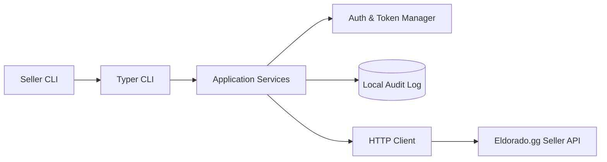

# Eldorado.gg Seller API Tool — Auto-Bidding Bot & Price Automation

[](https://www.python.org/)
[](LICENSE)
[]()
[]()

A high-performance command line (CLI) tool and automated pricing bot built on the official **Eldorado.gg Seller API**. Designed for verified sellers to automate price undercutting, prevent price wars with smart floor limits, manage offers, and receive instant real-time desktop alerts for pending delivery orders.

> [!IMPORTANT]
> **Status: ✅ Production Ready.** Built specifically for **TopUp (predefined) offers** across **any game** (Call of Duty Mobile, Brawl Stars, Clash of Clans, Roblox, etc.). Features an integrated local web UI (`http://127.0.0.1:8765`), smart price recovery, pilot validation, and non-destructive dry-run capabilities.

---

## ⚠️ Important Warning

> [!CAUTION]
> **Eldorado.gg has no test or sandbox environment.**
> Every write command in this tool changes your **live offers and orders** directly.
> - Preview with `--dry-run` before any change.
> - Try one offer before a bulk update.
> - Never share your `Client Secret`, never screenshot it, never push it to git.

---

## 📚 Documentation

| File | Description |
|---|---|
| [README.md](README.md) | Project overview, setup and usage guide |
| [ELDORADO_SELLER_API.md](ELDORADO_SELLER_API.md) | Notes from Eldorado's official article |
| [api-spec.md](api-spec.md) | API specification: what is confirmed, assumed or still unknown |
| [prd.md](prd.md) | Product requirements document (PRD): features, scope and open questions |
| [architecture.md](architecture.md) | System architecture and security model |
| [database.md](database.md) | Local data and audit log format |
| [requirement-validation.md](requirement-validation.md) | Requirement traceability and test plan |
| [AGENTS.md](AGENTS.md) | Rules for AI coding agents and developers |

---

## ✨ Features

- [x] **Token manager:** tokens expire after 15 minutes; the tool gets a new one by itself.
- [x] **Auto bidding:** 0.01 below the lowest price, never below Min. When a cheaper seller leaves, it goes up to Max to find the next seller.
- [x] **Settings page:** Min, Max and ON/OFF for each offer, and run/pause for the whole bot.
- [x] **New order alert:** checks every minute. A new order shows a banner on the page, plays a sound and sends a desktop notification. Lists orders waiting for delivery (red after 1 hour).
- [x] **Offer list, price change, pause / resume.**
- [x] **Online/offline.**
- [x] **Dry run (`--dry-run`)** and **audit log** (`logs/audit.jsonl`).
- [x] **Safety:** only one bot runs at a time. On a timeout or server error the bot pauses itself and never retries. It also pauses itself if `logs/audit.jsonl` cannot be written. Pressing Pause during a cycle stops the remaining price changes from being sent.
- [ ] Order list command, live deliver, creating new offers, CSV upload (not built yet).

What the Eldorado API does not support, this tool cannot do either: withdrawals, balance, messages, disputes, feedback, offer images and sales reports.

---

## 🛠️ Architecture Overview



---

## 🚀 Setup

### 1. Requirements
- **Python 3.11** or newer
- A **verified seller** account on Eldorado (only verified sellers can use the Seller API)
- Seller API credentials (Client ID and Client Secret)

### 2. Get credentials
1. Go to the [Eldorado Seller API dashboard](https://www.eldorado.gg/dashboard/seller-api).
2. Under "Generate API client credentials", enter a name and pick an expiry (1, 14, 30, 90 or 365 days).
3. Click **Generate credentials**.
4. Copy the **Client ID** and **Client Secret** somewhere safe. The secret is **shown only once** and cannot be viewed again.

An account can have at most 2 active credentials.

### 3. Installation
```powershell
cd <project folder>

python -m venv .venv
.venv\Scripts\Activate.ps1

pip install -e ".[dev]"

copy .env.example .env
```

**Easy way:** to do all the steps above at once, run this in the project folder:
```powershell
.\runme.ps1              # page + bot (bot starts PAUSED)
.\runme.ps1 -Mode ui     # page only, no bot
.\runme.ps1 -Port 9000 -NoBrowser
.\runme.ps1 -Reinstall   # run pip install again
```
The script creates `.venv` if it is missing, installs when needed, creates `.env` from `.env.example` if it is missing and opens it in Notepad, then runs `eldorado app`.

> If `Activate.ps1` fails (execution policy error), run this once: `Set-ExecutionPolicy -Scope CurrentUser RemoteSigned`

Put your credentials in the `.env` file:
```env
ELDORADO_CLIENT_ID=your_client_id_here
ELDORADO_CLIENT_SECRET=your_client_secret_here
ELDORADO_CREDENTIAL_EXPIRES=2027-02-12   # optional: credential expiry date, warns when 7 days are left
```

`.env` is listed in `.gitignore`, so it never goes to git.

---

## 💻 Commands

The full list of commands and options is in section 6.2 of [prd.md](prd.md). Every write command has `--dry-run` and `--yes`. The tool works with **TopUp offers** only.

### Check credentials
```powershell
eldorado auth check
```

### Offers (TopUp)
```powershell
eldorado offers list --limit 10                  # read-only, changes nothing
eldorado offers list --status active --game <gameId>
eldorado offers update --id <offer_id> --price 4.99 --dry-run
eldorado offers update --id <offer_id> --price 4.99
eldorado offers pause <offer_id> [<offer_id> ...]
eldorado offers resume <offer_id> [<offer_id> ...]
```

### 🤖 Auto Bidding
Keeps each offer's price **0.01 below** the lowest price of the other sellers. It never goes below `min_price`. If you are already the cheapest, the price stays as it is: the market shows only the cheapest offer of each package, so the next seller's price is not visible.

**Easiest:** double-click **Eldorado Bot** on the desktop. The page and the bot start together, and the bot starts **PAUSED**. Click the **Bot** button on the page to run it. Closing the window stops everything. (From a terminal: `eldorado app`)

To run the parts separately:

1. Open the settings page. It opens `http://127.0.0.1:8765` in the browser (only on your computer):
```powershell
eldorado ui
```
2. For each offer, enter **Min** (never goes below this) and **Max** (the highest price when searching for the next seller after a cheaper one leaves), tick **ON**, then press **Save**. **Preview** shows what prices the bot would set, and sends nothing.
3. First just look, nothing is sent:
```powershell
eldorado bid run --once --dry-run
```
4. Then run it live once, and check the prices on the dashboard:
```powershell
eldorado bid run --once
```
5. If everything looks right, keep it running (runs every 5 minutes, Ctrl+C to stop):
```powershell
eldorado bid run
```

If the result of a price change is unknown (timeout or server error), the bot stops by itself. Check the dashboard when that happens.

### Orders
```powershell
eldorado orders deliver <order_id> --dry-run   # works
eldorado orders deliver <order_id>             # live is still disabled
```

### Account
```powershell
eldorado status online
eldorado status offline
```

---

## 🧪 Testing

Tests never reach the live server. Every HTTP call is mocked with `respx`.

```powershell
pytest -v
pytest tests/test_dry_run.py -v
pytest --cov=src/eldorado --cov-report=term-missing
```

---

## 🔧 Troubleshooting

| Problem | What to do |
|---|---|
| Requests are rejected | The token may have expired; get a new one. If the token request fails too, check whether the credential was revoked or has expired. |
| Lost the Client Secret | It cannot be recovered. Revoke it on the dashboard, create a new one, then update `.env`. |
| The Generate button does nothing | You already have 2 active credentials. Revoke one. |
| The secret leaked | Revoke it right away and create a new one. |

If the problem continues, email Eldorado at **api@eldorado.gg** (the address given on the Seller API dashboard). Include your Client ID, which endpoint you called and when, and the full error message. **Never send the Client Secret.**

---

## 📄 Disclaimer

- This is not official Eldorado.gg software. It is a personal tool built on the Eldorado Seller API.
- No license has been chosen yet.
