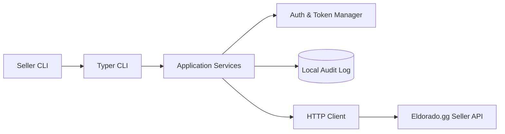

# Eldorado Seller API Tool

Eldorado.gg-এর অফিসিয়াল **Seller API** ব্যবহার করে বানানোর পরিকল্পনা করা একটি কমান্ড লাইন (CLI) টুল। এর লক্ষ্য হলো ভেরিফায়েড সেলারদের অফার (দাম, স্টক, ডেলিভারি সময়), অর্ডার (ডেলিভারড মার্ক করা) এবং অ্যাকাউন্ট স্ট্যাটাস (অনলাইন/অফলাইন) দ্রুত ও কম ভুলে ম্যানেজ করতে সাহায্য করা।

> [!IMPORTANT]
> **স্ট্যাটাস: ✅ চালু।** টুলটি শুধু **TopUp অফার** নিয়ে কাজ করে, **যেকোনো গেমের**। নতুন অফার আপলোড করলে পেজে নিজেই আসে, ডিলিট করলে চলে যায়। মূল কাজ **অটো বিডিং**: প্রতিটি অফারের দাম সবচেয়ে সস্তা অন্য সেলারের চেয়ে ০.০১ কম রাখা, কখনো আপনার Min-এর নিচে না।
> সব সেটিং একটি লোকাল পেজ থেকে হয়: `eldorado app` চালান, তারপর **http://127.0.0.1:8765** খুলুন।

---

## ⚠️ গুরুত্বপূর্ণ সতর্কতা

> [!CAUTION]
> **Eldorado.gg-তে কোনো টেস্ট বা স্যান্ডবক্স এনভায়রনমেন্ট নেই।**
> এই টুলের প্রতিটি রাইট (Write) কমান্ড সরাসরি আপনার **লাইভ অফার ও অর্ডার** পরিবর্তন করবে।
> - যেকোনো পরিবর্তনের আগে `--dry-run` দিয়ে প্রিভিউ দেখুন।
> - বাল্ক (Bulk) আপডেটের আগে ১টি অফারে পরীক্ষা করুন।
> - আপনার `Client Secret` কাউকে শেয়ার করবেন না, স্ক্রিনশট নেবেন না, গিটে পুশ করবেন না।

---

## 📚 ডকুমেন্টেশন

| ফাইল | বিবরণ |
|---|---|
| [README.md](README.md) | প্রজেক্ট ওভারভিউ, সেটআপ ও ব্যবহারের নির্দেশিকা |
| [ELDORADO_SELLER_API.md](ELDORADO_SELLER_API.md) | Eldorado-র অফিসিয়াল আর্টিকেলের নোট |
| [api-spec.md](api-spec.md) | API স্পেসিফিকেশন: কোনটা কনফার্মড, কোনটা অনুমান আর কোনটা এখনো অজানা |
| [prd.md](prd.md) | প্রডাক্ট রিকোয়ারমেন্ট ডকুমেন্ট (PRD): ফিচার, স্কোপ ও খোলা প্রশ্ন |
| [architecture.md](architecture.md) | সিস্টেম আর্কিটেকচার ও সিকিউরিটি মডেল (প্রস্তাবিত) |
| [database.md](database.md) | লোকাল ডাটাবেজ ডিজাইন (প্রস্তাবিত) |
| [requirement-validation.md](requirement-validation.md) | রিকোয়ারমেন্ট ট্রেসেবিলিটি ও টেস্ট প্ল্যান |
| [AGENTS.md](AGENTS.md) | AI কোডিং এজেন্ট ও ডেভেলপারদের নিয়ম |

---

## ✨ ফিচার

- [x] **টোকেন ম্যানেজার:** টোকেন ১৫ মিনিটে শেষ হয়, টুল নিজেই নতুন টোকেন নেয়।
- [x] **অটো বিডিং:** সবচেয়ে কম দামের চেয়ে ০.০১ কম, Min-এর নিচে কখনো না। সস্তা সেলার চলে গেলে Max পর্যন্ত উঠে পরের সেলার খোঁজে।
- [x] **সেটিংস পেজ:** প্রতিটি অফারের Min, Max, ON/OFF, আর পুরো বট চালু/পজ।
- [x] **নতুন অর্ডার অ্যালার্ট:** প্রতি মিনিটে চেক। নতুন অর্ডার এলে পেজে ব্যানার, শব্দ আর ডেস্কটপ নোটিফিকেশন। ডেলিভারির অপেক্ষায় থাকা অর্ডারের তালিকা (১ ঘণ্টার বেশি হলে লাল)।
- [x] **অফার লিস্ট, দাম পরিবর্তন, পজ / রিজ্যুম।**
- [x] **অনলাইন/অফলাইন।**
- [x] **ড্রাই-রান (`--dry-run`)** আর **অডিট লগ** (`logs/audit.jsonl`)।
- [x] **নিরাপত্তা:** একসাথে একটাই বট চলে। টাইমআউট বা সার্ভার এররে বট নিজেই পজ হয়, আবার চেষ্টা করে না। `logs/audit.jsonl` লেখা না গেলেও বট নিজেই পজ হয়। চলমান cycle-এর মাঝে Pause চাপলে বাকি দাম পরিবর্তন আর পাঠানো হয় না।
- [ ] অর্ডার লিস্ট, লাইভ ডেলিভার, নতুন অফার তৈরি, CSV আপলোড (এখনো বানানো হয়নি)।

Eldorado API যেগুলো সাপোর্ট করে না, এই টুলও সেগুলো পারবে না: উইথড্র, ব্যালেন্স, মেসেজ, ডিসপিউট, ফিডব্যাক, অফারের ছবি ও সেলস রিপোর্ট।

---

## 🛠️ আর্কিটেকচার সংক্ষেপ



---

## 🚀 সেটআপ

### ১. যা লাগবে
- **Python 3.11** বা তার পরের সংস্করণ
- Eldorado **ভেরিফায়েড সেলার** অ্যাকাউন্ট (শুধু ভেরিফায়েড সেলাররা Seller API ব্যবহার করতে পারেন)
- Seller API ক্রেডেনশিয়াল (Client ID ও Client Secret)

### ২. ক্রেডেনশিয়াল নিন
1. [Eldorado Seller API ড্যাশবোর্ডে](https://www.eldorado.gg/dashboard/seller-api) যান।
2. "Generate API client credentials"-এ একটি নাম দিন এবং মেয়াদ বেছে নিন (১, ১৪, ৩০, ৯০ বা ৩৬৫ দিন)।
3. **Generate credentials**-এ ক্লিক করুন।
4. **Client ID** ও **Client Secret** কপি করে নিরাপদ জায়গায় রাখুন। সিক্রেট **শুধু একবার দেখায়**, পরে আর দেখা যায় না।

একটি অ্যাকাউন্টে সর্বোচ্চ ২টি অ্যাক্টিভ ক্রেডেনশিয়াল থাকতে পারে।

### ৩. ইনস্টলেশন
```powershell
cd c:\Users\ASUS\Documents\eldorado_Seller_Api

python -m venv .venv
.venv\Scripts\Activate.ps1

pip install -e ".[dev]"

copy .env.example .env
```

**সহজ উপায়:** উপরের সব ধাপ একবারে করতে প্রজেক্ট ফোল্ডারে চালান:
```powershell
.\runme.ps1              # পেজ + বট (বট শুরুতে PAUSED)
.\runme.ps1 -Mode ui     # শুধু পেজ, বট ছাড়া
.\runme.ps1 -Port 9000 -NoBrowser
.\runme.ps1 -Reinstall   # আবার pip install করতে
```
স্ক্রিপ্টটি `.venv` না থাকলে বানায়, দরকার হলে ইনস্টল করে, `.env` না থাকলে `.env.example` থেকে বানিয়ে Notepad-এ খোলে, তারপর `eldorado app` চালায়।

> `Activate.ps1` চালাতে সমস্যা হলে (execution policy এরর), একবার চালান: `Set-ExecutionPolicy -Scope CurrentUser RemoteSigned`

`.env` ফাইলে আপনার ক্রেডেনশিয়াল বসান:
```env
ELDORADO_CLIENT_ID=your_client_id_here
ELDORADO_CLIENT_SECRET=your_client_secret_here
ELDORADO_CREDENTIAL_EXPIRES=2027-02-12   # ঐচ্ছিক: ক্রেডেনশিয়ালের মেয়াদ, ৭ দিন বাকি থাকলে সতর্ক করবে
```

`.env` ফাইল `.gitignore`-এ থাকবে, যাতে গিটে না যায়।

---

## 💻 কমান্ড

সব কমান্ড ও অপশনের পূর্ণ তালিকা [prd.md](prd.md)-র ৬.২ অংশে আছে। প্রতিটি রাইট কমান্ডে `--dry-run` ও `--yes` আছে। এই টুল শুধু **TopUp অফার** নিয়ে কাজ করে।

### ক্রেডেনশিয়াল চেক
```powershell
eldorado auth check
```

### অফার (TopUp)
```powershell
eldorado offers list --limit 10                  # শুধু পড়ে, কিছু বদলায় না
eldorado offers list --status active --game <gameId>
eldorado offers update --id <offer_id> --price 4.99 --dry-run
eldorado offers update --id <offer_id> --price 4.99
eldorado offers pause <offer_id> [<offer_id> ...]
eldorado offers resume <offer_id> [<offer_id> ...]
```

### 🤖 অটো বিডিং
প্রতিটি অফারের দাম অন্য সেলারদের সবচেয়ে কম দামের চেয়ে **০.০১ কম** রাখে। আপনি আগে থেকেই সবচেয়ে কম দামে থাকলে দাম বাড়িয়ে দ্বিতীয় দামের ০.০১ নিচে নেয়। `min_price`-এর নিচে কখনো নামে না।

**সবচেয়ে সহজ:** ডেস্কটপে **Eldorado Bot** ডাবল-ক্লিক করুন। পেজ আর বট একসাথে চালু হবে, বট শুরুতে **PAUSED** থাকে। পেজে **Bot** বাটনে ক্লিক করলে চলবে। উইন্ডো বন্ধ করলে সব থামবে। (টার্মিনাল থেকে: `eldorado app`)

আলাদা করে চালাতে:

১. সেটিংস পেজ খুলুন। ব্রাউজারে `http://127.0.0.1:8765` খুলবে (শুধু আপনার কম্পিউটারে):
```powershell
eldorado ui
```
২. প্রতিটি অফারে **Min** (এর নিচে কখনো নামবে না), **Max** (সস্তা সেলার চলে গেলে পরের সেলার খুঁজতে সর্বোচ্চ এই দাম) দিন, **ON** টিক দিন, তারপর **Save** চাপুন। **Preview** চাপলে দেখাবে বট কী দাম বসাত, কিছু পাঠায় না।
৩. প্রথমে শুধু দেখুন, কিছু পাঠাবে না:
```powershell
eldorado bid run --once --dry-run
```
৪. তারপর একবার লাইভ চালান, আর ড্যাশবোর্ডে দাম মিলিয়ে দেখুন:
```powershell
eldorado bid run --once
```
৫. সব ঠিক থাকলে চালু রাখুন (প্রতি ৫ মিনিটে চলে, থামাতে Ctrl+C):
```powershell
eldorado bid run
```

কোনো দাম পরিবর্তনের ফল অজানা থাকলে (timeout বা সার্ভার এরর) বট নিজেই থেমে যায়। তখন ড্যাশবোর্ডে চেক করুন।

### অর্ডার
```powershell
eldorado orders deliver <order_id> --dry-run   # কাজ করে
eldorado orders deliver <order_id>             # লাইভ এখনো বন্ধ রাখা আছে
```

### অ্যাকাউন্ট
```powershell
eldorado status online
eldorado status offline
```

---

## 🧪 টেস্টিং

টেস্ট কখনো লাইভ সার্ভারে যায় না। সব HTTP কল `respx` দিয়ে মক করা।

```powershell
pytest -v
pytest tests/test_dry_run.py -v
pytest --cov=src/eldorado --cov-report=term-missing
```

---

## 🔧 সমস্যা ও সমাধান

| সমস্যা | কী করবেন |
|---|---|
| রিকোয়েস্ট রিজেক্ট হচ্ছে | টোকেনের মেয়াদ শেষ হয়ে থাকতে পারে, নতুন টোকেন নিন। টোকেন রিকোয়েস্টও ফেল করলে দেখুন ক্রেডেনশিয়াল রিভোক হয়েছে বা মেয়াদ শেষ হয়েছে কিনা। |
| Client Secret হারিয়ে গেছে | ফেরত পাওয়া যায় না। ড্যাশবোর্ডে রিভোক করে নতুন বানান, তারপর `.env` আপডেট করুন। |
| Generate বাটন কাজ করছে না | ইতিমধ্যে ২টি অ্যাক্টিভ ক্রেডেনশিয়াল আছে। একটি রিভোক করুন। |
| সিক্রেট লিক হয়ে গেছে | সঙ্গে সঙ্গে রিভোক করে নতুন বানান। |

সমস্যা না মিটলে Eldorado-কে **api@eldorado.gg**-তে ইমেইল করুন (Seller API ড্যাশবোর্ডে দেওয়া ঠিকানা)। ইমেইলে Client ID, কোন এন্ডপয়েন্ট ও কখন কল করেছিলেন, আর পুরো এরর মেসেজ দিন। **Client Secret কখনো দেবেন না।**

---

## 📄 ডিসক্লেইমার

- এটি Eldorado.gg-এর কোনো অফিসিয়াল সফটওয়্যার নয়। Eldorado Seller API ব্যবহার করে বানানো একটি ব্যক্তিগত টুল।
- লাইসেন্স এখনো ঠিক করা হয়নি।
