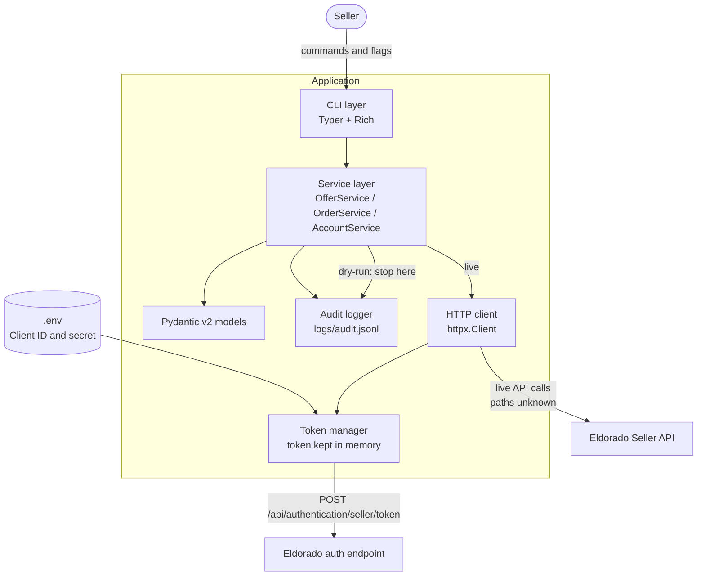
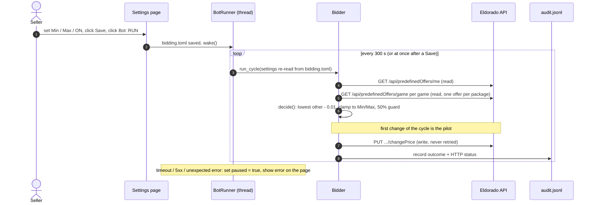
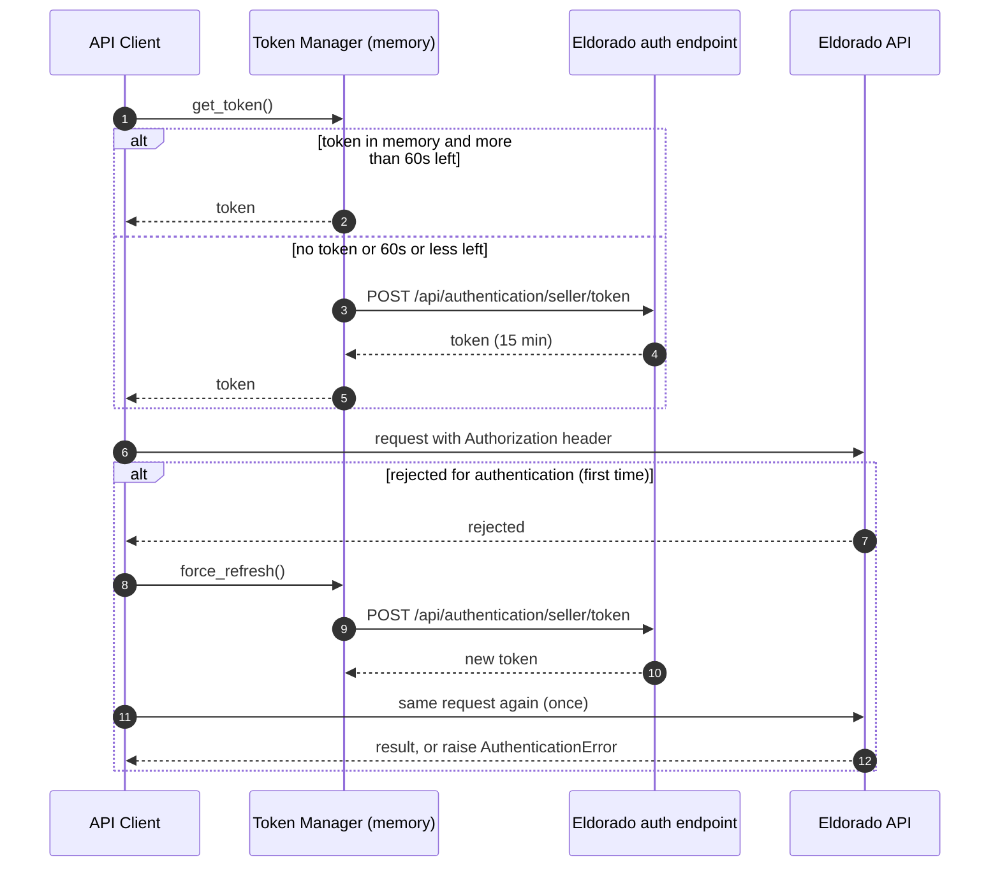

# Architecture Design: Eldorado Seller API Tool

This document describes the proposed architecture of the **Eldorado Seller API CLI Tool**.

> **Source of truth:** [prd.md](prd.md) defines the tech stack, folder structure, CLI commands and safety rules. If this file disagrees with `prd.md`, `prd.md` wins.
> **Endpoints:** The token endpoint and `PUT /api/orders/me/{orderId}/delivered` are confirmed (the deliver request body is not). Every other endpoint is unknown (see [api-spec.md](api-spec.md)), so the diagrams below name *operations*, not URL paths.

---

## 1. Architectural Principles

1. **Safety first.** Eldorado has **no sandbox**. Every write goes through dry-run support, a before/after preview, a confirmation prompt, a 1-item pilot for multi-item changes, and a 50% price-change guard.
2. **Layered separation.** CLI (presentation) -> services (business rules) -> client (HTTP) -> Eldorado. Lower layers never import upper layers.
3. **Automatic authentication.** Callers never handle tokens. The token manager gets and renews the 15-minute token.
4. **Safe retries.** Reads may be retried. Writes are **never** retried automatically after a timeout or server error, because the change may already be applied.
5. **No secret leaks.** The Client secret and access token never reach logs, disk, terminal output or exceptions.
6. **Keep it small.** One user, one process, synchronous code, no database in the MVP.

---

## 2. High-Level System Architecture



---

## 3. Layers

Folder names follow `prd.md` section 6.1.

### 3.1 CLI layer (`src/eldorado/cli/`)
- `typer` commands, `rich` tables and colors.
- Parses arguments, shows the before/after table, asks for confirmation.
- Example prompt:
  ```
  About to pause 3 offer(s) on the LIVE account.
  Pilot: <first id> goes first.
  Continue? [y/N]
  ```
- Contains no business rules and no HTTP code.

### 3.2 Service layer (`src/eldorado/services/`)
- `OfferService`: selects offers, computes the before/after diff, applies the 50% price guard, runs the pilot, then the rest, and builds the success/failure summary.
- `OrderService`: marks an order delivered (dry-run only; live is disabled).
- `AccountService`: sets online or offline.
- `Bidder` (`services/bidding.py`, F16): each cycle reads your TopUp offers (`/api/predefinedOffers/me`) and the market for each game once (`/api/predefinedOffers/game`), then `decide()` (a pure function) picks the target price per offer from `bidding.toml`. The first change is the pilot; a failed pilot stops the cycle; an unknown write outcome stops the bot. 1 second delay between writes. `eldorado bid run` repeats the cycle every `interval_seconds` (default 300).
- Writes an audit record for every change, including dry runs.
- When `dry_run=True`, a service never calls a write method on the client.

- `eldorado app` (`services/bot_runner.py`): the bot runs in a daemon thread next to the page server, each with its own HTTP client. Starts with `paused = true`; a page Save wakes the bot immediately. `WriteOutcomeUnknownError` or `AuthenticationError` sets `paused = true` in `bidding.toml` and shows the error on the page (no retry, no silent stop).
- `eldorado ui` (`cli/ui.py`, `cli/ui_page.py`, `services/dashboard.py`, F17): stdlib `http.server` bound to 127.0.0.1. Host header check + random per-run token on every API call + strict CSP. Reads offers/market, saves `bidding.toml` atomically, previews `Bidder.plan()`. Never writes to Eldorado.
- Config for the bidder: `core/bidding_config.py` reads `bidding.toml` (stdlib `tomllib`, no new dependency).

### 3.3 Models (`src/eldorado/models/`)
- Pydantic v2 models: `Money` (MoneyBaseDTO), `Offer` (predefined/TopUp offer, with `product_key()` to match the same package across sellers), `CompetitorOffer`, `OfferPage`, `PriceChange`, `DeliverResult`, `TokenResponse`.
- Prices use `Decimal`, never `float`.
- Validation: price > 0, quantity >= 0.
- Field names follow the Swagger schemas (api-spec.md 4.6).

### 3.4 Client layer (`src/eldorado/client/`)
- `base.py`: one `httpx.Client` with timeouts, error mapping and retry rules.
- `auth.py`: token manager.
- `offers.py`, `orders.py`, `account.py`: one method per API operation. Paths come from the Swagger spec (api-spec.md 4). `offers.py` covers TopUp (predefined) offers only.

**Retry rules** (from `prd.md` section 5.3):

| Situation | Action |
|---|---|
| Authentication rejected | New token, retry **once**, then raise `AuthenticationError` |
| Rate limited (assumed 429) | Wait (`Retry-After` if present), maximum 3 tries |
| Read: network error or 5xx | Exponential backoff with jitter, maximum 3 tries |
| Write: timeout, network error or 5xx | **No retry.** Raise `WriteOutcomeUnknownError` and tell the user to check the dashboard |

### 3.5 Core (`src/eldorado/core/`)
- `config.py`: `pydantic-settings` reads `.env`.
- `exceptions.py`: `AuthenticationError`, `RateLimitExceededError`, `ResourceNotFoundError`, `WriteOutcomeUnknownError`, `EldoradoAPIError`.
- `logging.py`: replaces the secret, the token and any `Authorization` header value with `***REDACTED***`.
- `audit.py`: appends one JSON line per change to `logs/audit.jsonl` (format in [database.md](database.md)).

---

## 4. Sequence Diagrams

### 4.1 Safe Bulk Price Update



If the pilot fails, the service stops and nothing else is changed.

### 4.2 Token Lifecycle



Each CLI command is a new process, so it requests one new token at start. That is one extra request per command, which is acceptable and avoids storing the token on disk.

---

## 5. Security

1. **Credentials:** only in `.env`, which is in `.gitignore`. `.env.example` has field names only.
2. **Access token:** only in memory. Never written to disk, a database or logs.
3. **Log masking:** the secret value, the token value and `Authorization` header values are replaced with `***REDACTED***`.
4. **Accidental changes:**
   - Write commands ask for confirmation. `--yes` skips the prompts but never skips the pilot.
   - `--dry-run` sends no write requests at all.
   - Price changes over 50% need `--allow-big-change`.
5. **Only official endpoints:** no website internal endpoints or HAR-derived calls.
